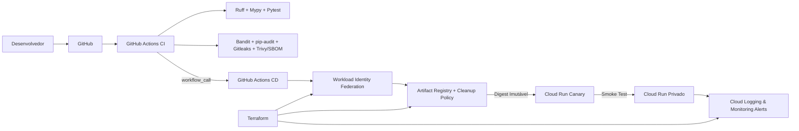

# Arquitetura

## Responsabilidades

- **Aplicação (`app/`):** API FastAPI em camadas (`core`, `schemas`, `repositories`, `services`, `api`) com logs JSON estruturados, erros RFC 9457, probes `/health/live` e `/health/ready` e idempotência em pedidos.
- **Terraform (`infra/`):** APIs GCP, Artifact Registry com política de retenção/limpeza, Service Accounts segregadas, federação OIDC e políticas de alerta no Cloud Monitoring (erros 5xx e latência p95).
- **GitHub Actions (`.github/workflows/`):** CI com gate obrigatório para CD, validação de IaC (`terraform.yml`), Gitleaks, Trivy (imagem e IaC) e publicação de SBOM CycloneDX.
- **Cloud Run:** Hospeda a API sem servidores gerenciados, privada por padrão, com deploy canary por digest imutável.

## Decisões Registradas (ADRs)

- [ADR 001 - Autenticação OIDC via Workload Identity Federation](adr/001-autenticacao-oidc-wif.md)
- [ADR 002 - Canary Deploy por Digest Imutável no Cloud Run](adr/002-canary-deploy-digest-imutavel.md)
- [ADR 003 - Arquitetura em Camadas, Repository Pattern e Idempotência](adr/003-arquitetura-em-camadas-e-idempotencia.md)
